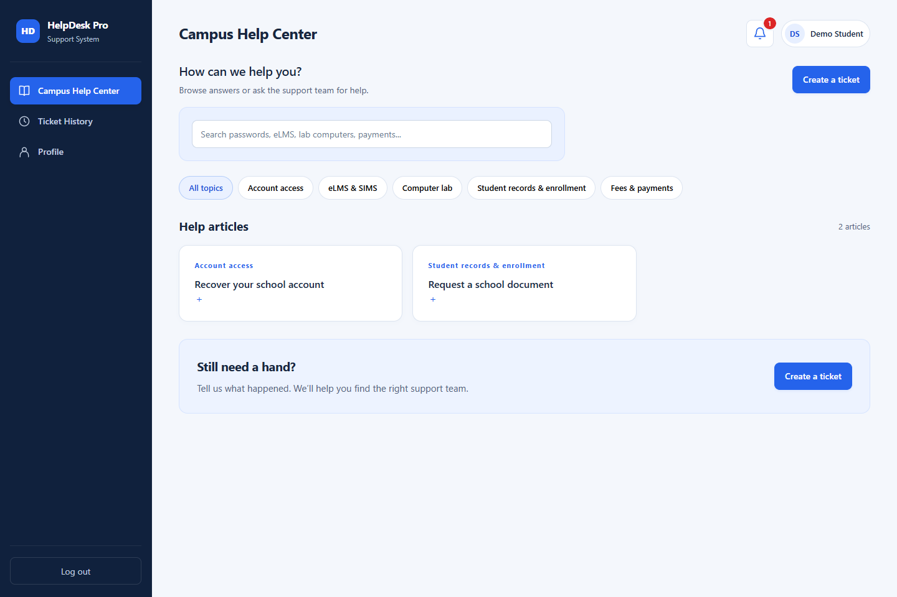
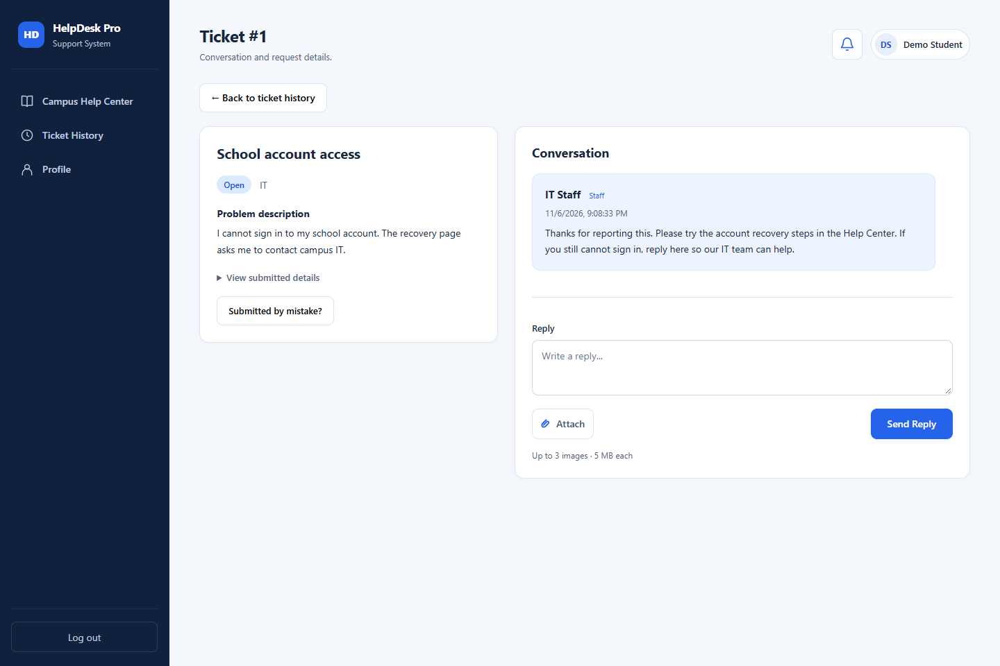
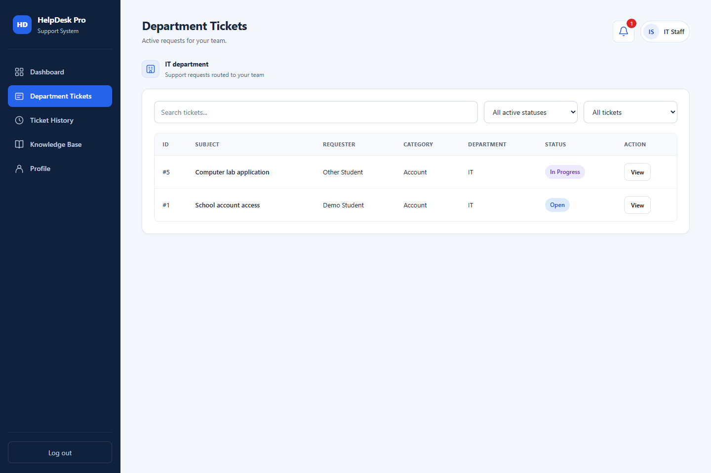
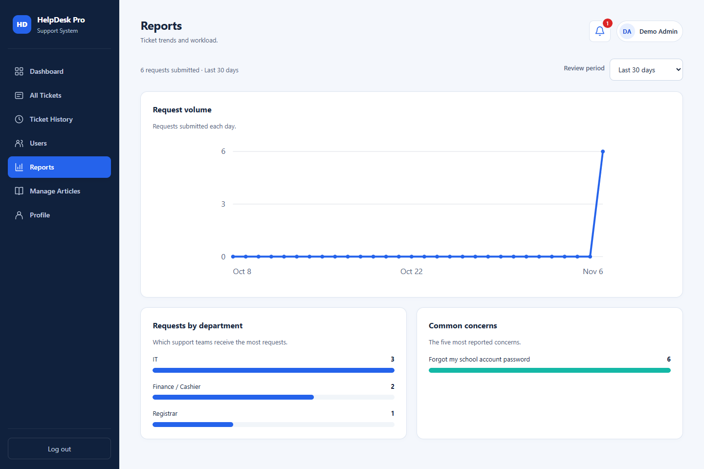

<div align="center">

# HelpDesk Pro

**Campus support, all in one place.**

Find answers, submit a ticket, and follow your request from the first reply to resolution.

**A BSIT 2-104 school group project · Class project prototype**

[Open the web app](https://adrianpasamonte.github.io/Campus-Help-Desk/app.html) · [Features](#features) · [Screenshots](#screenshots) · [Run locally](#run-locally)

</div>



## About the project

HelpDesk Pro is a campus help desk and ticketing web application developed as a **school group project**. It uses student concerns at STI Ortigas-Cainta as its reference, connecting Students with IT, Registrar, and Finance / Cashier support workflows.

This is a class project prototype and is **not an official school service**. It records and routes concerns; it does not reset school accounts, change grades, process payments, or issue school documents. School procedures and office response schedules still need to be confirmed by the team.

## Features

- [x] Separate Student, Staff, and Admin workflows.
- [x] Searchable knowledge base with campus topics and guided support articles.
- [x] Guided ticket creation and automatic department routing.
- [x] Ticket history with active, resolved, and closed requests.
- [x] Ticket conversations with a reply composer and submitted-details disclosure.
- [x] Image attachments, previews, individual removal, validation, and upload retry.
- [x] Bell icon, floating notifications, unread indicators, and ticket links.
- [x] Assignment, department transfer, and resolution handling.
- [x] Student confirmation to close a resolved ticket or reopen it if the issue remains.
- [x] Admin tools for Staff accounts, article publishing, and reports.
- [x] Responsive layouts, compact navigation, and floating confirmation dialogs.

Attachments support PNG, JPEG, and WebP: **up to 3 images per submission, 5 MB per image**. Files are stored privately in Supabase and opened through temporary signed URLs.

## Screenshots

Screenshots show the current interface using **synthetic demonstration accounts and records**. They do not contain real student tickets or account credentials. The hosted application uses the existing project backend; these screenshot fixtures are not included in the public app.

### Ticket conversation

Request information and the conversation sit side by side on wider screens. Submitted form answers remain available under **View submitted details**.



<details>
<summary><strong>Staff department tickets</strong></summary>

Staff review tickets routed to their department and filter requests by status.



</details>

<details>
<summary><strong>Admin reports</strong></summary>

Admins can review request volume, department workload, and commonly reported concerns.



</details>

## User roles

| Role | Main responsibilities |
| --- | --- |
| **Student** | Search help articles, create requests, view their own ticket history, send replies and screenshots, and confirm or reopen a resolution. |
| **Staff** | View department tickets and handle eligible unassigned requests or requests assigned to them. Tickets assigned to another staff member remain read-only. |
| **Admin** | Oversee all departments, assign and transfer tickets, create Staff/Admin accounts, maintain articles, and review reports. |

Public registration creates Student accounts. Staff/Admin accounts are created through the Admin workflow. Frontend controls reflect each role; the existing backend access policies and functions enforce access separately.

## How a request works

1. A Student searches the Campus Help Center or chooses **Create a ticket**.
2. The selected topic and concern guide the form and route the request.
3. Staff or an Admin reviews the request and exchanges replies with the Student.
4. Support marks the ticket **Resolved**, including a resolution note.
5. The Student confirms it is fixed to close the request, or reopens it for further help.

| Support topic | Destination |
| --- | --- |
| Account access, eLMS & SIMS, computer lab | IT |
| Student records & enrollment | Registrar |
| Fees & payments | Finance / Cashier |
| Others | Admin review |

## Technology

| Layer | Technology |
| --- | --- |
| Interface | HTML, CSS, JavaScript |
| Authentication and data | Supabase Auth and PostgreSQL |
| Access control | Supabase database policies and server-side functions |
| Attachments | Private Supabase Storage |
| Frontend hosting | GitHub Pages |

The frontend has **three application source files** and no build step. The pinned Supabase JavaScript client **2.119.0** is bundled inside `app.js`, with its MIT notice retained.

```text
Campus-Help-Desk/
├── app.html              # Screens, forms, and dialogs
├── app.js                # Application behavior and Supabase integration
├── style.css             # Styling and responsive layouts
├── docs/screenshots/     # Images used in this README
├── README.md
└── .gitignore
```

## Run locally

Requirements: a modern browser, an internet connection for Supabase, and a local HTTP server. Python 3 is one option; VS Code Live Server also works.

```bash
git clone https://github.com/AdrianPasamonte/Campus-Help-Desk.git
cd Campus-Help-Desk
python -m http.server 5500 --bind 127.0.0.1
```

Open **[http://127.0.0.1:5500/app.html](http://127.0.0.1:5500/app.html)**. On Windows, use `py -m http.server 5500 --bind 127.0.0.1` if your Python launcher is `py`.

Serve the folder over HTTP rather than opening the file directly. The local server serves the interface; Supabase provides authentication, stored data, and attachments. The hosted GitHub Pages version requires no local server.

### Backend setup

This frontend is connected to the group's existing Supabase project. **Cloning it does not create a new backend.** To use another project, provision its tables, role policies, private attachment bucket, and account-management functions before updating the connection settings in `app.js`.

Only the frontend publishable key belongs in browser code. Keep service-role keys and other server credentials out of the repository.

Password recovery and email confirmation require matching Supabase Auth URL settings. The hosted application address is:

```text
https://adrianpasamonte.github.io/Campus-Help-Desk/app.html
```

Allow its `?recovery=1` redirect and the corresponding local address when testing recovery.
